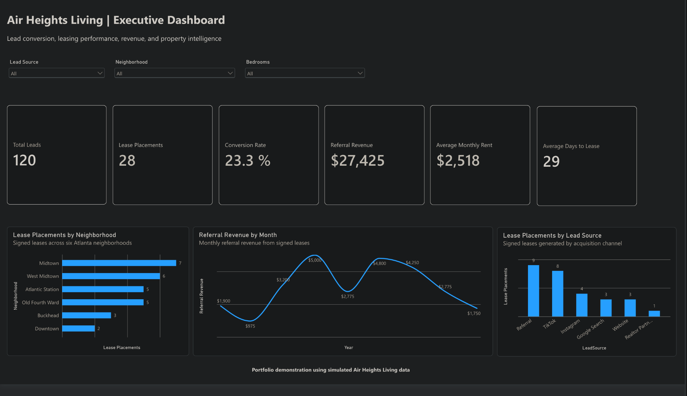
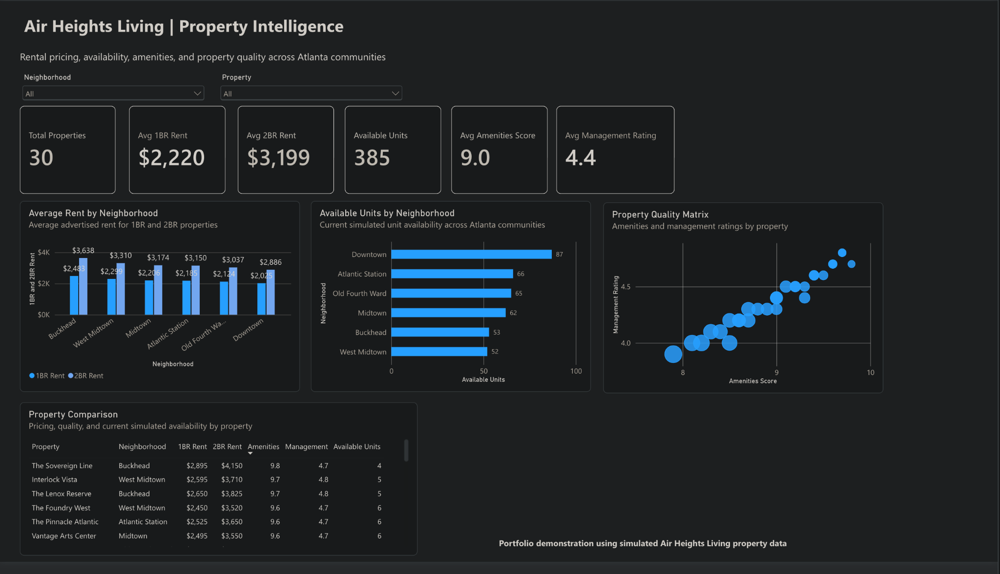
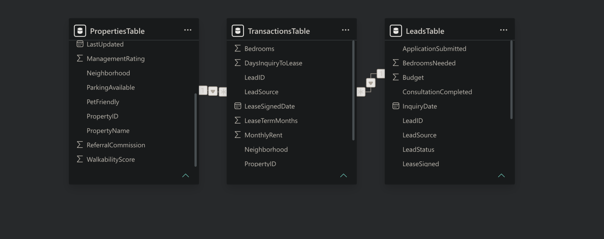
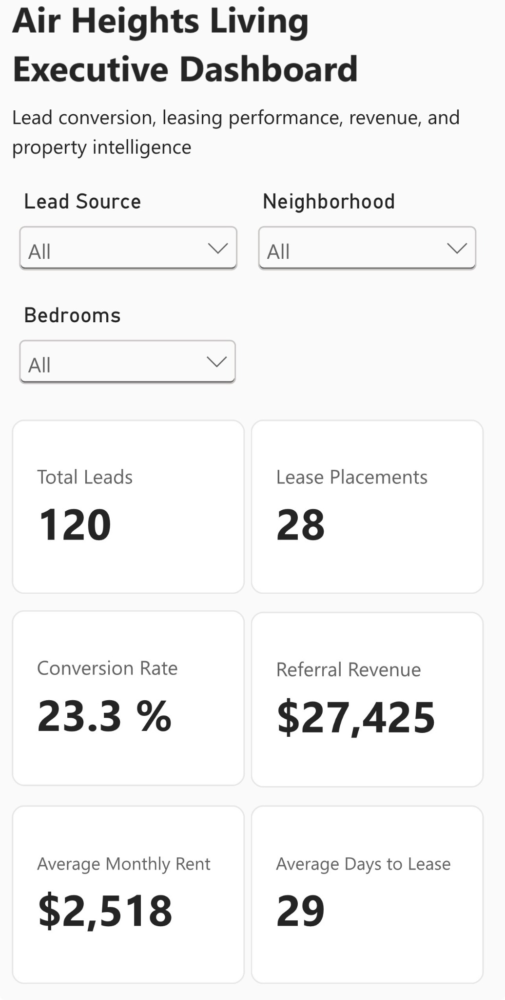
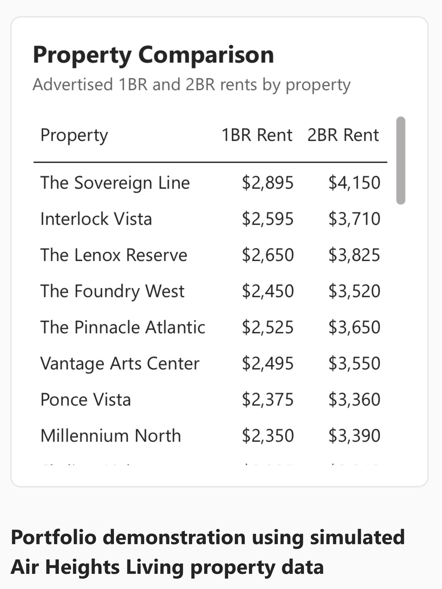
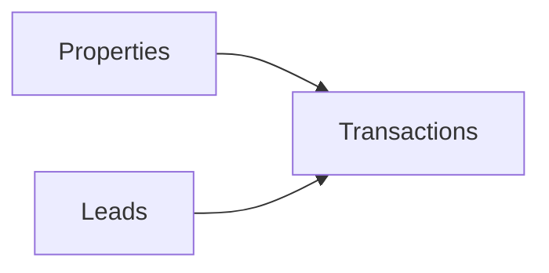

# Air Heights Living | Real Estate Business Intelligence

Power BI real estate business intelligence project focused on lead conversion, leasing performance, referral revenue, neighborhood performance, property intelligence, and mobile reporting.

> Portfolio project using simulated operating and property data.

## Project Overview

Air Heights Living is an Atlanta-based residential advisory concept. This two-page Power BI solution demonstrates how a placement business could connect marketing activity to completed leases while also supporting property-level comparison and renter advisory decisions.

## Dashboard Preview

### Executive Dashboard


### Property Intelligence


### Semantic Model


### Mobile Executive Dashboard


### Mobile Property Comparison


## Business Questions

- Which lead sources generate completed leases rather than just inquiries?
- How effectively are leads converting to signed leases?
- Which neighborhoods produce the most placement activity?
- How much referral revenue is being generated?
- How long does it take to convert an inquiry into a lease?
- How do rents and available inventory differ by neighborhood?
- Which properties offer the strongest combination of pricing, amenities, management quality, and availability?

## Key Results

| Metric | Result |
|---|---:|
| Total Leads | 120 |
| Lease Placements | 28 |
| Conversion Rate | 23.3% |
| Referral Revenue | $27,425 |
| Average Monthly Rent | $2,518 |
| Average Days to Lease | approx. 29 |
| Properties | 30 |
| Average 1BR Rent | $2,220 |
| Average 2BR Rent | $3,199 |
| Available Units | 385 |
| Average Amenities Score | 9.0 |
| Average Management Rating | 4.4 |

## Key Findings

- Referral generated the most completed placements with 9 leases.
- TikTok generated 8 placements and the strongest conversion rate at approximately 42.1%.
- Midtown produced the most completed placements with 7.
- May generated the highest monthly referral revenue at $5,000, followed by July at $4,800.
- Buckhead had the highest average advertised rents.
- Downtown combined the lowest average pricing with the greatest available inventory.

## Semantic Model



The model separates lead activity, completed lease transactions, and property inventory so lead generation is not confused with completed business.

See [Data Model & Architecture](docs/data-model.md).

## Analytical Logic

Reusable calculations were developed for Total Leads, Lease Placements, Conversion Rate, Average Monthly Rent, Referral Revenue, and Average Days to Lease.

See [KPI Reference](docs/kpi-reference.md).

## Mobile Optimization

Both report pages were redesigned for mobile use instead of relying only on automatic phone layout. The mobile version uses reorganized KPI cards, resized visuals, simplified labels, and a mobile-friendly Property Comparison table.

## Tools & Skills

Power BI • Power Query • DAX • Data Modeling • KPI Development • Lead Conversion Analysis • Real Estate Analytics • Revenue Analysis • Property Intelligence • Mobile Report Optimization

## Repository Structure

```text
air-heights-living-power-bi/
├── README.md
├── data/
│   └── Air_Heights_Living_PowerBI_Starter.xlsx
├── docs/
│   ├── data-model.md
│   └── kpi-reference.md
└── screenshots/
    ├── executive-dashboard.png
    ├── property-intelligence.png
    ├── semantic-model.png
    ├── mobile-executive-dashboard.jpg
    └── mobile-property-comparison.jpg
```

## Data Disclaimer

This project was created for portfolio demonstration using simulated data. It does not represent confidential operating data from a real organization.
